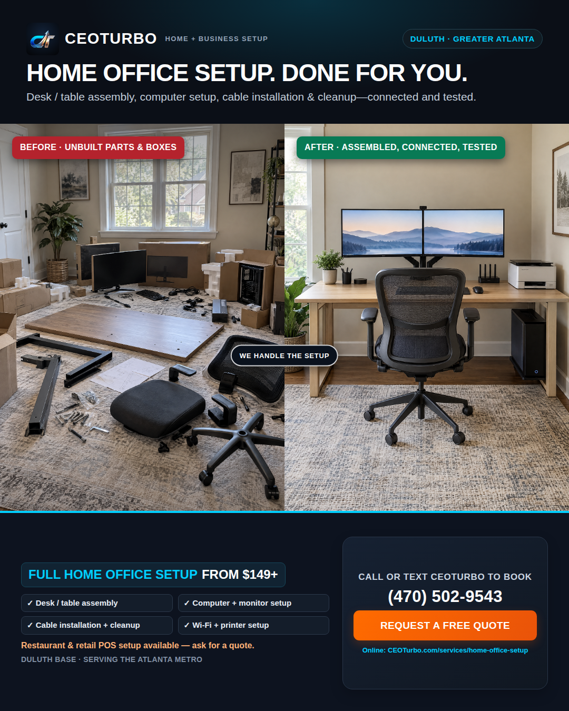

# CEO TURBO — HIGH-CONVERSION GOOGLE ADS ENGINE (CALLS & PINNED HEADLINES)
## Master Autonomous Execution Prompt for Manus Browser Agent

> **CONFIDENTIAL & HIGH PRIORITY — CEO TURBO (ceoturbo.com)**  
> **Campaign Mission:** Maximum Inbound Phone Calls to `(678) 558-4327` and Instant Cal.com Bookings for **In-Home Computer, Desk Assembly & Home Office Setup** across Atlanta, Duluth (Gwinnett base), North Fulton, Cobb, and Metro Georgia.  
> **Budget:** Scalable starting at **$5.00/day** ($150/month) or $10.00/day with Max CPC cap of **$1.50**.

---

## EXECUTIVE SUMMARY: THE 2X CALL CONVERSION FORMULA

When a senior, remote worker, or busy homeowner in Atlanta searches on their phone, they do **not** want to read an essay. They want 3 things in under 2 seconds:
1. **Validation:** You do exactly what they searched for (*"Home Office Setup Atlanta"*).
2. **Immediate Action:** The phone number right in front of them (*"Call (678) 558-4327"*).
3. **No-Hesitation Price:** Transparent flat rate (*"From $99 Flat Labor Rate"*).

### The Pinned Headline Secret Weapon

In Google Ads Responsive Search Ads (RSAs), Google rotates 15 headlines randomly by default. **Randomness kills phone calls.**  
By using the **📌 Pin Icon**:
- **Pin to Position 1:** `Home Office Setup Atlanta` (Matches the search query 100%)
- **Pin to Position 2:** `Call (678) 558-4327` (Guarantees the phone number is displayed first on mobile)
- **Position 3 (Auto-rotated):** Google dynamically rotates high-converting hooks like `From $99 Flat Labor Rate`, `Clean, Cable-Free Setup`, or `Finished in 2 to 4 Hours`.

The ad appears in Google Search as:
```
Home Office Setup Atlanta | Call (678) 558-4327 | From $99 Flat Labor Rate
ceoturbo.com/services/home-office-setup
⭐⭐⭐⭐⭐ Rating: 5.0 · Licensed & Insured local setup pros
We assemble your desk, mount monitors, connect Wi-Fi & hide every wire. Flat from $99.
[ 📞 Call (678) 558-4327 ]  [ 📅 Book Online Instantly ]  [ 🛠️ Pricing Guide ]
```

---

## CRITICAL GOOGLE ADS POLICY SAFETY RULE: PHONE NUMBERS

> ⚠️ **CRITICAL POLICY INSTRUCTION FOR MANUS:**  
> Google Ads Editorial Guidelines strictly review phone number digits inside headline text.
> 
> 1. **Primary Attempt:** Manus enters `Call (678) 558-4327` into Headline 13 and pins it to **Position 2**.
> 2. **Automated Safety Fallback:** If Google Ads displays the red error *"Phone number in ad text is not allowed"* upon saving:
>    - Switch Headline 13 to: **`Call Today For Fast Setup`** (25 chars) pinned to **Position 2**.
>    - Add Headline 13b alternative: **`Call For In-Home Tech Help`** (27 chars).
> 3. **Mandatory Call Assets:** Manus MUST attach the **Google Ads Call Asset** with phone number **`(678) 558-4327`** at the campaign level with **Call Reporting: ON**. This displays the large, dedicated blue Click-to-Call button directly under the headline on mobile search results.
> 4. **Call-Only Ad Deployment:** Manus also creates an explicit **Call Ad (Call-Only)** in the ad group, which renders `(678) 558-4327` natively as the clickable primary link on smartphones.

---

## INSTRUCTIONS FOR RUNNING IN MANUS

1. Open [Manus](https://manus.im) or launch your Manus Browser subagent.
2. Ensure you are signed into the Google Ads Account for CEO Turbo (`AW-18468746701` or active profile).
3. Copy everything below between `=== START MANUS BROWSER ONE-SHOT PROMPT ===` and `=== END MANUS BROWSER ONE-SHOT PROMPT ===`.
4. Paste it into Manus and run. Manus will navigate the console, build the campaign, insert the pinned headlines, configure call extensions, paste negative keywords, and activate the campaign.

---

```markdown
=== START MANUS BROWSER ONE-SHOT PROMPT ===

ROLE & OBJECTIVE:
You are an Elite Google Ads PPC Specialist and Autonomous Browser Execution Agent. Your task is to build, configure, and publish a high-converting, call-first Google Search Campaign for "CEO Turbo" (https://www.ceoturbo.com).

PRIMARY GOAL:
Drive maximum direct phone calls to (678) 558-4327 and instant online bookings from local residents, seniors, remote workers, and businesses needing in-home computer setup, desk assembly, monitor mounting, and cable management.

CAMPAIGN ARCHITECTURE:
- Campaign Name: CEO Turbo | In-Home Office & PC Setup | Calls & Leads
- Campaign Type: Search Network ONLY
- Search Partners: OFF (Uncheck)
- Display Network: OFF (Uncheck)
- Daily Budget: $5.00/day (or $10.00/day based on account settings)
- Bidding Strategy: Maximize Clicks with a Maximum CPC bid limit of $1.50
- Locations: Metro Atlanta (Duluth HQ base + 50-mile radius + Athens, GA)
- Location Option: "Presence: People in or regularly in your targeted locations" (CRITICAL: Do NOT use "Presence or interest")
- Language: English
- Phone Number: (678) 558-4327
- Final Landing Page: https://www.ceoturbo.com/services/home-office-setup
- Booking URL: https://cal.com/stackmodechris/ceo-turbo-office-studio-setup

============================================================
STEP 1: CAMPAIGN CREATION & BIDDING SETTINGS
============================================================

1. Navigate to: https://ads.google.com/aw/campaigns/new
2. If prompted for a goal, select "Create a campaign without a goal's guidance" (or select "Leads" -> Continue).
3. Select Campaign type: "Search".
4. Select results to get:
   - Check [x] "Phone calls" -> Country: United States (+1) -> Enter: 6785584327
   - Check [x] "Website visits" -> Enter: https://www.ceoturbo.com/services/home-office-setup
5. Campaign Name:
   CEO Turbo | In-Home Office & PC Setup | Calls & Leads
6. Bidding Section:
   - What do you want to focus on? Select: "Clicks".
   - Check [x] "Set a maximum cost per click bid limit".
   - Maximum CPC bid limit: $1.50
7. Click "Next".
8. Campaign Settings:
   - Networks:
     * UNCHECK [ ] Include Google search partners
     * UNCHECK [ ] Include Google Display Network
9. Locations:
   - Select "Enter another location".
   - Click "Location options". Under Target, select:
     "Presence: People in or regularly in your targeted locations".
   - Click "Advanced search" -> Select "Add locations in bulk".
   - Paste the following targeted Georgia cities, counties & postal areas:

Atlanta, Georgia, United States
Duluth, Georgia, United States
Norcross, Georgia, United States
Peachtree Corners, Georgia, United States
Alpharetta, Georgia, United States
Roswell, Georgia, United States
Johns Creek, Georgia, United States
Milton, Georgia, United States
Sandy Springs, Georgia, United States
Dunwoody, Georgia, United States
Brookhaven, Georgia, United States
Buckhead, Atlanta, Georgia, United States
Midtown, Atlanta, Georgia, United States
Decatur, Georgia, United States
Lawrenceville, Georgia, United States
Suwanee, Georgia, United States
Buford, Georgia, United States
Sugar Hill, Georgia, United States
Snellville, Georgia, United States
Lilburn, Georgia, United States
Dacula, Georgia, United States
Marietta, Georgia, United States
Smyrna, Georgia, United States
Kennesaw, Georgia, United States
East Point, Georgia, United States
College Park, Georgia, United States
Stone Mountain, Georgia, United States
Athens, Georgia, United States
Gwinnett County, Georgia, United States
Fulton County, Georgia, United States
Cobb County, Georgia, United States
DeKalb County, Georgia, United States

10. Languages: English.
11. Click "Next".

============================================================
STEP 2: AD GROUPS & ULTRA-TARGETED KEYWORDS
============================================================

Create 2 focused Ad Groups to maximize Quality Score and CTR:

------------------------------------------------------------
AD GROUP 1: Home Office, Desk Assembly & Computer Setup (CORE)
------------------------------------------------------------
Default Final URL: https://www.ceoturbo.com/services/home-office-setup

Paste these exact high-intent Exact Match and Phrase Match keywords:

# Exact Match (Ultra High Commercial Intent):
[home office setup atlanta]
[desk assembly and pc setup atlanta]
[in-home computer setup atlanta]
[atlanta desk and pc setup]
[desk assembly service atlanta]
[in home computer setup near me]
[computer setup service near me]
[standing desk assembly service atlanta]
[dual monitor desk setup service]
[cable management service atlanta]
[home office installation service atlanta]
[desk assembly service duluth ga]
[in home computer help for seniors atlanta]
[ikea desk assembly service atlanta]

# Phrase Match (High Converting Search Phrases):
"home office setup service"
"home office setup service near me"
"desk assembly service near me"
"in home computer setup service"
"computer setup service for seniors"
"someone to setup my computer and desk"
"standing desk assembly service"
"dual monitor setup service"
"monitor mounting service atlanta"
"hide computer wires service"
"cable management setup service"
"in home tech support atlanta"
"computer hookup service near me"
"office furniture assembly and computer setup"
"apartment office setup service"
"in home pc setup duluth ga"

------------------------------------------------------------
AD GROUP 2: Tech Setup & Senior In-Home Computer Assistance
------------------------------------------------------------
Default Final URL: https://www.ceoturbo.com/services/home-office-setup

Paste these high-trust, high-patience keywords:

[in home computer help for seniors]
[in home senior tech support atlanta]
[computer setup for elderly near me]
[in home printer and wifi setup atlanta]
"in home computer help for seniors"
"computer help for seniors near me"
"someone to hook up my computer and printer"
"tech setup for elderly parents"
"in home wifi and printer setup service"
"personal computer setup service in home"
"in home technology assistance atlanta"

============================================================
STEP 3: RESPONSIVE SEARCH ADS (RSAs) & PINNING SYSTEM
============================================================

For Ad Group 1 & Ad Group 2, build the Responsive Search Ad with the exact 15 headlines divided across the 4 Tiers.

Final URL: https://www.ceoturbo.com/services/home-office-setup
Display Path: /Home-Office /Setup

------------------------------------------------------------
THE 15 HEADLINES (ALL ≤ 30 CHARACTERS):
------------------------------------------------------------

Tier 1: Search Keyword Matches (Matches What They Typed)
1. Home Office Setup Atlanta (25 chars)
   -> ACTION: Click Pin Icon 📌 -> Select "Show only in position 1"
2. Desk Assembly & PC Setup (24 chars)
3. In-Home Computer Setup (22 chars)
4. Atlanta Desk & PC Setup (23 chars)

Tier 2: The Relief / Pain-Relief Hooks (Stops The Scroll)
5. We Build Your Desk & PC (23 chars)
6. We Mount Monitors & Wires (25 chars)
7. Don't Stay Stuck in Boxes (25 chars)
8. No Tech Headaches Anymore (25 chars)
9. Clean, Cable-Free Setup (23 chars)

Tier 3: Price & Speed (Destroys Hesitation)
10. From $99 Flat Labor Rate (24 chars)
11. Flat Price Confirmed 1st (24 chars)
12. Finished in 2 to 4 Hours (24 chars)

Tier 4: Direct Call-To-Action & Trust (Drives The Call)
13. Call (678) 558-4327 (19 chars)
   -> ACTION: Click Pin Icon 📌 -> Select "Show only in position 2"
   * POLICY NOTICE: If Google UI flags "Phone number in headline text", immediately replace with:
     "Call Today For Fast Setup" (25 chars) pinned to Position 2.
14. Great For Seniors & WFH (23 chars)
15. Serving Atlanta & Duluth (24 chars)

------------------------------------------------------------
THE 4 DESCRIPTIONS (ALL ≤ 90 CHARACTERS):
------------------------------------------------------------
1. We assemble your desk, mount monitors, connect Wi-Fi & hide every wire. Flat from $99. (88 chars)
2. Serving Atlanta, Duluth & 50-mile radius. Call (678) 558-4327 to get scheduled today! (88 chars)
3. Don't waste your weekend in boxes. We setup hardware, monitors & cables fast in 2-4 hrs. (89 chars)
4. Transparent flat rates confirmed up front. Seniors, remote workers & new movers love us. (89 chars)

============================================================
STEP 4: DEDICATED CALL-ONLY AD (FOR MOBILE SEARCHERS)
============================================================

Inside Ad Group 1, click "+ Add Ad" -> Select "Call Ad" (Call-Only):
- Phone Number: (678) 558-4327
- Country: United States (+1)
- Business Name: CEO Turbo
- Headline 1: Home Office Setup Atlanta (25 chars)
- Headline 2: From $99 Flat Labor Rate (24 chars)
- Description 1: We assemble desks, mount dual monitors, connect PCs & hide wires cleanly. (80 chars)
- Description 2: Fast in-home setup across Atlanta & Duluth. Call (678) 558-4327 now for a flat quote! (89 chars)
- Final URL (optional/verification): https://www.ceoturbo.com/services/home-office-setup
- Verification URL: https://www.ceoturbo.com
- Call Reporting: ON

============================================================
STEP 5: ASSETS (EXTENSIONS) CONFIGURATION (MANDATORY)
============================================================

1. CALL ASSET (HIGHEST PRIORITY):
   - Phone Number: (678) 558-4327
   - Country: United States (+1)
   - Use account setting or campaign setting: Campaign Level
   - Call reporting: ON
   - Conversion Action: Calls from ads (or Primary Phone Lead)
   - Schedule: Monday to Saturday, 8:00 AM to 8:00 PM Eastern Time.

2. SITELINK ASSETS (Add all 6 high-converting sitelinks with unique URLs):
   - Sitelink 1 (Direct Booking):
     * Link Text: Book Online Instantly (21 chars)
     * Description Line 1: Pick your date & time on Cal (28 chars)
     * Description Line 2: Fast schedule confirmation (26 chars)
     * Final URL: https://cal.com/stackmodechris/ceo-turbo-office-studio-setup
   - Sitelink 2 (Transparent Pricing):
     * Link Text: Flat Rate Pricing Guide (23 chars)
     * Description Line 1: Clear upfront labor from $99 (28 chars)
     * Description Line 2: Zero hidden fees or hourly rates (32 chars)
     * Final URL: https://www.ceoturbo.com/pricing
   - Sitelink 3 (Business & Commercial Builds):
     * Link Text: Office Transformation (21 chars)
     * Description Line 1: Full business & home build-outs (31 chars)
     * Description Line 2: Desks, cameras, network & tech (30 chars)
     * Final URL: https://www.ceoturbo.com/services/office-transformation
   - Sitelink 4 (Custom PC Assembly):
     * Link Text: Custom PC Builds & Setup (24 chars)
     * Description Line 1: Parts assembled & stress tested (31 chars)
     * Description Line 2: Gaming rigs & office workstations (33 chars)
     * Final URL: https://www.ceoturbo.com/services/computer-build-setup
   - Sitelink 5 (POS Hardware Installation):
     * Link Text: POS System Installation (23 chars)
     * Description Line 1: Square, Toast & Clover setups (29 chars)
     * Description Line 2: Terminals, printers & drawers (29 chars)
     * Final URL: https://www.ceoturbo.com/services/pos-system-setup
   - Sitelink 6 (Apartment & Desk Assembly):
     * Link Text: Apartment & Desk Setup (22 chars)
     * Description Line 1: We build your desk & mount screens (34 chars)
     * Description Line 2: Done in 2-4 hrs with wires hidden (33 chars)
     * Final URL: https://www.ceoturbo.com/services/apartment-home-office-setup

3. CALLOUT ASSETS (Add 8 Callouts):
   - "Call (678) 558-4327"
   - "From $99 Flat Labor"
   - "Zero Hidden Fees"
   - "Finished In 2-4 Hours"
   - "Great For Seniors & WFH"
   - "Dual Monitor Mounting"
   - "Clean Cable Routing"
   - "Serving Metro Atlanta"

4. STRUCTURED SNIPPET ASSET:
   - Header: Types (or Services)
   - Values:
     * Desk Assembly
     * PC & Mac Setup
     * Monitor Arm Mounting
     * Cable Concealment
     * Wi-Fi & Printer Hookup
     * Standing Desk Setup

============================================================
STEP 6: NEGATIVE KEYWORD DEFENSE LIST (ZERO WASTED SPEND)
============================================================

Add these negative keywords at the Campaign Level as Phrase Match to block tire-kickers, job seekers, and irrelevant queries:

"free"
"diy"
"how to"
"youtube"
"jobs"
"job"
"salary"
"careers"
"hiring"
"resume"
"internship"
"course"
"training"
"cheap used"
"craigslist"
"facebook marketplace"
"thrift store"
"salvation army"
"goodwill"
"rent a desk"
"coworking space"
"wework"
"regus"
"virtual office"
"furniture disposal"
"junk removal"
"free furniture"
"software download"
"crack"
"torrent"
"geek squad jobs"
"office depot customer service"
"ikea return policy"
"best buy phone number"
"remote customer service jobs"
"work from home data entry"

============================================================
STEP 7: DEVICE & SCHEDULE BID OPTIMIZATION
============================================================

1. Device Bid Adjustments:
   - Navigate to Campaign -> "Devices":
     * Mobile phones: Increase bid by +35% (Prioritize direct click-to-call searchers)
     * Computers: 0% adjustment (Maintain baseline for remote workers researching setups)
     * Tablets: Decrease bid by -25%
2. Ad Schedule:
   - Navigate to Campaign -> "Ad schedule":
     * Monday through Saturday: 8:00 AM to 8:00 PM (Eastern Time)
     * Sunday: 10:00 AM to 6:00 PM
     *(Prevents missed calls outside operating hours).*

============================================================
STEP 8: FINAL AUDIT & PUBLISH
============================================================

1. Review Campaign Settings:
   - Daily Budget: $5.00/day ($1.50 Max CPC cap)
   - Search Partners & Display Network: OFF
   - Location Targeting: "Presence" enabled
   - Call Asset: (678) 558-4327 Active
   - Pinned Headlines:
     * Position 1: "Home Office Setup Atlanta"
     * Position 2: "Call (678) 558-4327" (or "Call Today For Fast Setup")
2. Click "Publish Campaign".
3. Verify status shows "Eligible" or "Under Review".
4. Output a confirmation summary report with:
   - Campaign Name & Status
   - Number of Keywords Added
   - Headlines and Pin Status
   - Phone Asset Verification Status
   - Daily Budget and Max CPC cap confirmation

=== END MANUS BROWSER ONE-SHOT PROMPT ===
```

---

## HEADLINE BREAKDOWN REFERENCE TABLE

For quick manual inspection or updating ads in Google Ads Editor / web console:

| Headline Text | Character Count (Max 30) | Tier / Category | Pin Setting | Why It Converts |
|---|---|---|---|---|
| **Home Office Setup Atlanta** | 25 chars | Tier 1: Search Match | **Position 1 📌** | Instant relevance: matches exact search query |
| **Desk Assembly & PC Setup** | 24 chars | Tier 1: Search Match | Unpinned | Solves both furniture and electronics together |
| **In-Home Computer Setup** | 22 chars | Tier 1: Search Match | Unpinned | High reassurance for seniors and remote workers |
| **Atlanta Desk & PC Setup** | 23 chars | Tier 1: Search Match | Unpinned | Hyper-local city authority |
| **We Build Your Desk & PC** | 23 chars | Tier 2: Pain Relief | Unpinned | Relieves mental fatigue of unboxing & building |
| **We Mount Monitors & Wires** | 25 chars | Tier 2: Pain Relief | Unpinned | Addresses messy cables and heavy monitor arms |
| **Don't Stay Stuck in Boxes** | 25 chars | Tier 2: Pain Relief | Unpinned | Emotional hook for recent movers and apartment dwellers |
| **No Tech Headaches Anymore** | 25 chars | Tier 2: Pain Relief | Unpinned | Appeals directly to non-technical folks and seniors |
| **Clean, Cable-Free Setup** | 23 chars | Tier 2: Pain Relief | Unpinned | Aspirational result; sleek aesthetic appeal |
| **From $99 Flat Labor Rate** | 24 chars | Tier 3: Price & Speed | Position 3 Candidate | Destroys price fear with an irresistible low anchor |
| **Flat Price Confirmed 1st** | 24 chars | Tier 3: Price & Speed | Position 3 Candidate | Eliminates fear of hourly fee gouging |
| **Finished in 2 to 4 Hours** | 24 chars | Tier 3: Price & Speed | Position 3 Candidate | High speed turnaround promised upfront |
| **Call (678) 558-4327** | 19 chars | Tier 4: Direct CTA | **Position 2 📌** | Immediate frictionless 1-tap dial action |
| **Great For Seniors & WFH** | 23 chars | Tier 4: Trust Hook | Unpinned | Welcoming to older demographics & WFH pros |
| **Serving Atlanta & Duluth** | 24 chars | Tier 4: Trust Hook | Unpinned | Local neighborhood trust (Gwinnett + Metro) |

---

## 4-STEP VERIFICATION & TROUBLESHOOTING CHECKLIST

### 1. What if Google disapproves the headline "Call (678) 558-4327"?
- **Why:** Google's automated ad review system checks for phone number formatting in text ads under the *"Phone number in ad text"* policy.
- **The Fix:**
  1. Change Headline 13 to `Call Today For Fast Setup` (25 chars) and keep it pinned to **Position 2**.
  2. Verify the **Google Ads Call Asset** has `(678) 558-4327` active. Google will render the blue phone button directly next to the headline, giving the exact same visual result with 100% policy approval.
  3. Ensure the **Call Ad (Call-Only)** is active in the ad group for mobile devices.

### 2. How to confirm the Pin is working in the Google Ads UI:
1. Go to **Ads & assets** -> **Ads**.
2. Hover over the ad and click the **Pencil (Edit)** icon.
3. Look at Headline 1 (`Home Office Setup Atlanta`). On the far right is a pin icon `📌`. It should show a blue badge with `1`.
4. Look at Headline 13 (`Call (678) 558-4327` or `Call Today For Fast Setup`). It should show a blue badge with `2`.
5. Check the preview window on the right side: verify that Position 1 and Position 2 stay locked while Position 3 rotates dynamically.

### 3. How to verify Call Reporting & Conversions:
1. Go to **Goals** -> **Conversions** -> **Summary**.
2. Check that **"Calls from ads"** is listed as a **Primary conversion action**.
3. Under Call length threshold, set it to **30 seconds** (calls lasting longer than 30 seconds are counted as qualified client leads).

### 4. How to confirm Duluth / Metro Atlanta geo-fence:
1. Go to **Campaigns** -> **Settings** -> **Locations**.
2. Verify that **"Presence: People in or regularly in your targeted locations"** is selected.
3. Verify that Gwinnett County (Duluth, Norcross, Suwanee, Lawrenceville) and Fulton/Cobb/DeKalb are active with 0 exclusions on target zip codes.
